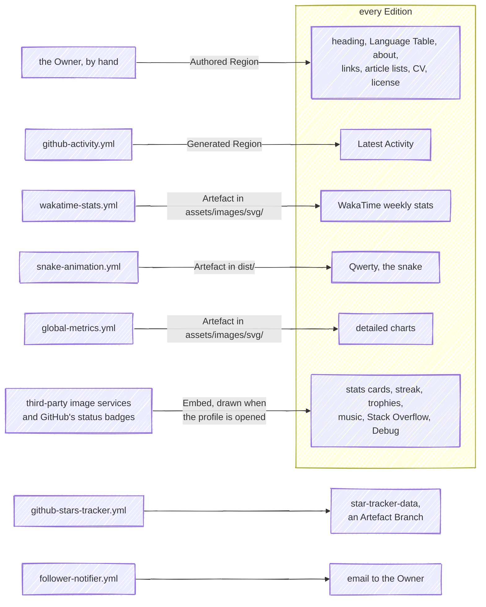
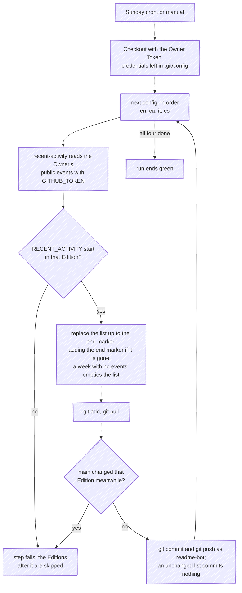
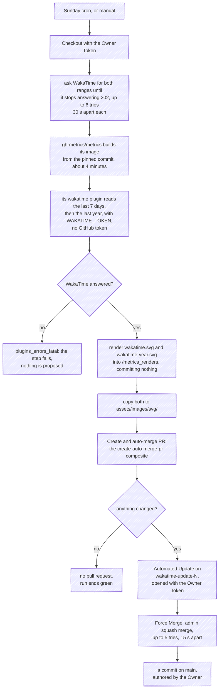
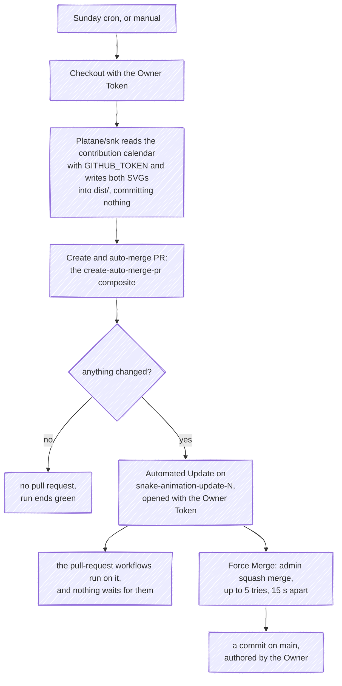
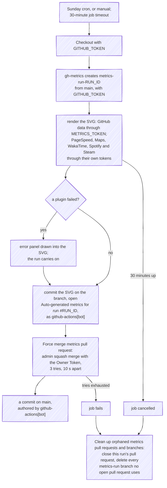
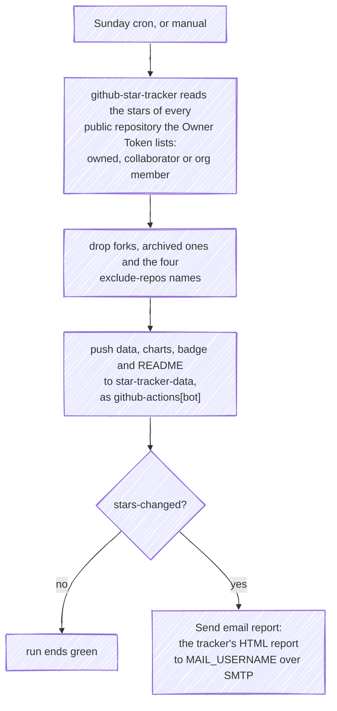
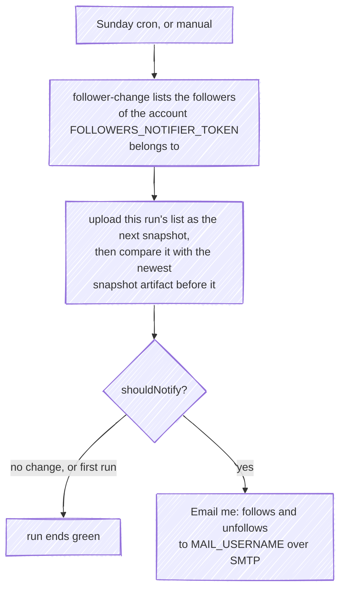
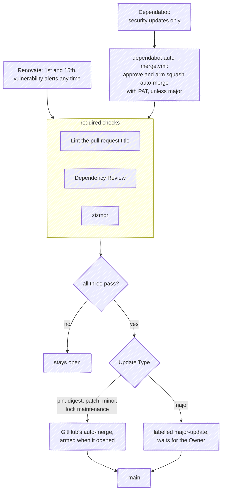
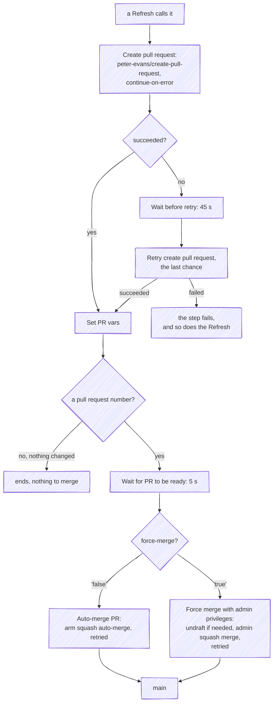

# Architecture

How the profile is put together and why. What a reader sees is the [Canonical Edition](./README.md) itself; the
vocabulary is [GLOSSARY.md](./GLOSSARY.md); how to work here is [AGENTS.md](./AGENTS.md); what a review checks
is [CODING_STANDARDS.md](./CODING_STANDARDS.md). This document does not restate them.

## 1. What the profile is made of

There is no application here, so "architecture" means where each part of an Edition comes from. Every Edition
is the same stack of sections, and each section reaches the reader by one of four routes: an **Authored
Region** written by hand, a **Generated Region** a Refresh rewrites between markers, an **Artefact** a Refresh
commits as a file, or an **Embed** a third-party server draws when the profile is opened.

Section by section, named as the Canonical Edition heads them; the other Editions carry the same sections in
the same order:

| Section | Route | Source |
| --- | --- | --- |
| Heading, hero image and quotes | Authored Region | Written by hand; the images are files under [`assets/images/`](./assets/images) |
| Language Table | Authored Region | Written by hand in every Edition; the flags are under [`assets/images/png/flags/`](./assets/images/png/flags) |
| The *working on*, *learning*, *ask me about* lines | Authored Region | Written by hand |
| *Download my Resume* | Authored Region | [`assets/pdf/Ferran-Buireu-CV.pdf`](./assets/pdf/Ferran-Buireu-CV.pdf), committed by hand; nothing here regenerates it |
| *How to reach me* | Authored Region of Embeds | Links written by hand, each drawn as an `img.shields.io` badge |
| *dev delusions*: Medium and Hashnode | Authored Region | Article lists kept by hand |
| *dev delusions*: Stack Overflow | Embed | `github-readme-stackoverflow.vercel.app` |
| *Latest Activity* | Generated Region | `<!--RECENT_ACTIVITY:start-->` … `<!--RECENT_ACTIVITY:end-->`, rewritten by [`github-activity.yml`](./.github/workflows/github-activity.yml) |
| *Top repositories*, *Top Contributions & Streak*, *Languages & Stats*, *Trophies* | Embeds | `github-readme-stats-fast.vercel.app`, `github-readme-activity-graph.vercel.app`, `github-readme-streak-stats.herokuapp.com`, `github-profile-trophy.vercel.app` |
| *Wakatime stats*, *Weekly stats* | Artefact | [`assets/images/svg/wakatime.svg`](./assets/images/svg/wakatime.svg), written by [`wakatime-stats.yml`](./.github/workflows/wakatime-stats.yml) and quoted by relative path |
| *Wakatime stats*, *Yearly stats* | Artefact | [`assets/images/svg/wakatime-year.svg`](./assets/images/svg/wakatime-year.svg), written by the same Refresh and quoted the same way |
| *Wakatime stats*, *Overall Languages* | Embed | `github-readme-stats-fast.vercel.app/api/wakatime` |
| *My exquisite music taste* | Embed | `spotify-recently-played-readme.vercel.app` |
| Qwerty, the contribution snake | Artefact | [`dist/github-contribution-grid-snake.svg`](./dist/github-contribution-grid-snake.svg) and its `-dark` twin, written by [`snake-animation.yml`](./.github/workflows/snake-animation.yml) and quoted from `raw.githubusercontent.com/…/main/dist/` |
| *Wanna see more detailed charts?* | Artefact | [`assets/images/svg/github-metrics.svg`](./assets/images/svg/github-metrics.svg), written by [`global-metrics.yml`](./.github/workflows/global-metrics.yml) and quoted by relative path |
| *Debug* | Embeds | GitHub's status badges for the six scheduled workflows; see §2 |
| *License* | Authored Region | Written by hand |

When a reader opens the profile, GitHub renders the Canonical Edition as it stands on `main`. The Generated
Region is already text in it, the Artefacts are files in this repository, and every Embed is fetched through
GitHub's image proxy at that moment, from a server this repository does not run. Two scheduled workflows feed
nothing the profile shows: the star tracker writes an Artefact Branch no Edition quotes, and the follower
notifier only sends email.

## 2. The weekly refreshes

Six workflows run on a schedule, and they share one cron, `0 0 * * 0`, Sunday at 00:00 UTC; each also accepts
`workflow_dispatch`. GitHub starts scheduled runs late when it is busy, and midnight UTC is busy. Over the eight
Sundays from 2026-08-23 to 2026-10-11 they started at these times, in this order every week:

| Workflow | Started (UTC) | Lands as | Commit identity on `main` |
| --- | --- | --- | --- |
| [`github-activity.yml`](./.github/workflows/github-activity.yml) | 00:27 to 02:56 | a direct push per Edition | `readme-bot`, recent-activity's own name, with the GitHub Actions noreply address |
| [`follower-notifier.yml`](./.github/workflows/follower-notifier.yml) | 00:34 to 03:10 | an email | none |
| [`snake-animation.yml`](./.github/workflows/snake-animation.yml) | 00:51 to 03:37 | an Automated Update and a Force Merge | the Owner as author, GitHub as committer of the squash |
| [`github-stars-tracker.yml`](./.github/workflows/github-stars-tracker.yml) | 01:04 to 04:07 | a push to the Artefact Branch, and an email | `github-actions[bot]`, on `star-tracker-data` |
| [`wakatime-stats.yml`](./.github/workflows/wakatime-stats.yml) | 01:10 to 04:19 | an Automated Update and a Force Merge | the Owner as author, GitHub as committer of the squash |
| [`global-metrics.yml`](./.github/workflows/global-metrics.yml) | 01:49 to 05:32 | an Automated Update and a Force Merge | `github-actions[bot]` as author, GitHub as committer of the squash |

That order is what GitHub happened to do, not a promise. Each workflow's `concurrency` group serialises its own
runs and nothing else, so two Refreshes that write the same Edition, a manual dispatch, or a hand commit landing
mid-run can still meet. What each writer does when they do is in its own flow below.

The activity Refresh reaches `main` without a pull request only because the Owner Token belongs to an admin and the
`main` ruleset lets the admin role bypass it; with any other token its pushes would be refused.

**How a failure gets noticed.** The *Debug* section at the foot of every Edition carries GitHub's status badge
for each of the six workflows, and a red one means that workflow's latest run failed. GitHub also emails a
failed scheduled run to whoever last changed that workflow's cron line. Neither sees the failures that end
green: a plugin of the metrics Refresh that draws an error panel into its SVG.

### Recent activity

One job, one checkout, four steps: *Run recent activity (EN)*, *(CA)*, *(IT)* and *(ES)*, each the same pinned
`Readme-Workflows/recent-activity` given its Edition's config (§3). It reads `GET /users/{user}/events/public`
with `GITHUB_TOKEN`, and pushes with the Owner Token the checkout left behind, which is why that checkout is the
one in the tree with `persist-credentials: true` ([ADR 0002](./docs/adr/0002-workflows-act-as-the-owner.md)).
An unchanged list commits nothing.

- **A missing start marker is loud.** The step stops with *Couldn't find the `<!--RECENT_ACTIVITY:start-->`
  comment. Exiting!*, and since the steps run in sequence, every Edition after it keeps last week's list. The
  marker is checked before the events are, so a missing one fails even a week with no events. A missing end
  marker is repaired: the action writes the list and the end marker after the start one.
- **A week with no events empties the list.** The action pads its list to five lines before it tests for an
  empty one, so that test never passes and its *No events found. Leaving readme unchanged.* never shows: with
  nothing to report it deletes last week's lines, writes none, and commits the empty region.
- **A collision fails the step.** `git pull` refuses when a commit that reached `main` since the checkout
  touched the Edition it has staged, and `git push` is rejected if one lands between the pull and the push.
  Either way the later Editions are skipped too.
- **An expired Owner Token** stops the run at the checkout, before any Edition is touched.

### WakaTime

One job, running the action the metrics Refresh runs, at the same pin, twice, with every section but its WakaTime
plugin switched off: `base: ""` drops the GitHub sections, and `token: NOT_NEEDED` tells the action not to read GitHub at
all, so each step holds `WAKATIME_TOKEN` and no GitHub credential; the plugin never reads GitHub, so a token would
change nothing it draws. `output_action: none` leaves the renders in `/metrics_renders` instead of committing
them; the workflow copies them to `assets/images/svg/wakatime.svg` and `wakatime-year.svg`, which is what gives the
composite action something to propose (§4), as `Platane/snk` does for the snake. One card covers the last seven
days and the other the last year, each with the total and the daily average, the top project, language, editor
and operating system, and a graph of the eight largest of each. The second step finds the image the first one
built, so the year costs seconds. All four Editions quote both files by relative path, so their labels are
English in every Edition.

- **WakaTime answers stale numbers while it recalculates.** The first request for a range whose cached stats
  are out of date gets `202 Calculating stats for this user` with the old figures, and the plugin draws whatever it
  gets: the first manual run, on 2026-10-22, drew the previous Sunday's week. *Wait for WakaTime to finish
  calculating the stats* asks for both ranges first and retries only on 202, every 30 seconds, six times at most,
  then lets the run carry on; any other answer, a refused token included, ends the wait at once with a warning in
  the run summary and leaves the failure to the metrics step. It sends the key as `api_key`, trimmed, the way the
  plugin does: the first version sent it as Basic authentication, got `401` for both ranges and waited for nothing.
- **A WakaTime failure is loud.** `plugins_errors_fatal: yes` turns a refused or revoked `WAKATIME_TOKEN` into a
  failed step, so nothing is proposed, the *Debug* badge goes red and both cards on `main` stay last week's. The
  same token fails green in the metrics Refresh, as an error panel (below).
- **Every run builds the metrics image** before it renders anything, and the build is most of the run. Why it is
  built rather than pulled is in [ADR 0003](./docs/adr/0003-third-party-actions-are-pinned-to-commit-shas.md).
- **Opening and merging fail as the snake's do** (below): one retry of the pull request after 45 seconds, then
  five merge attempts, after which the run fails and the Automated Update stays open for the Owner.
- **An expired Owner Token** stops the run at the checkout.

### Snake

`Platane/snk` renders `dist/github-contribution-grid-snake.svg` and the `-dark` variant from the Owner's
contribution calendar and leaves them uncommitted, which is what gives the composite action something to propose
(§4). Because the Owner Token opens the pull request, the pull-request workflows do run on it, which is why its
title is a Conventional Commit; the Force Merge does not wait for them
([ADR 0001](./docs/adr/0001-automated-updates-land-through-a-self-merging-pull-request.md)). The branch goes when
the pull request merges.

- **Opening the pull request can race** another Refresh. The composite tries once more after 45 seconds; if
  that fails too, the run fails and nothing lands.
- **A merge that keeps failing** exhausts its five tries, the run fails, and the Automated Update stays open
  for the Owner.
- **An expired Owner Token** stops the run at the checkout.

### Metrics

The metrics action owns its commit step, so it is told `output_action: pull-request` and opens the Automated
Update itself with `GITHUB_TOKEN`; a separate step force-merges it with the Owner Token
([ADR 0001](./docs/adr/0001-automated-updates-land-through-a-self-merging-pull-request.md)). A pull request
opened with `GITHUB_TOKEN` starts none of this repository's workflows, so the required `zizmor` check never
reports on it and the Force Merge is the only way in. CodeQL's default setup, which GitHub runs itself rather than
a workflow in the tree, does analyse it. The head branch is deleted by the merge.

- **A dead plugin token gives a green run.** `plugins_errors_fatal: no` tells the action to draw a plugin's error
  into its section of the SVG and carry on, so a revoked Spotify, Steam, PageSpeed, Maps or WakaTime token, or a
  skyline page whose DOM changed, lands on `main` as an error panel with every check green. Only opening the
  detailed charts shows it.
- **A timeout ends the run cancelled, not failed.** The action creates `metrics-run-<run_id>` before it renders,
  and the render is the slow part, so a run that hits the 30-minute limit leaves that branch behind with no pull
  request on it. The cleanup step runs on `failure() || cancelled()` for that reason: it closes this run's pull
  request if there is one, then deletes every `metrics-run-*` branch that no open pull request uses, which also
  sweeps up anything an earlier run left.
- **A Force Merge that keeps failing**, for instance on an expired Owner Token, fails the run after its three
  tries, and the same cleanup closes the pull request.

### Star tracker

`fbuireu/github-star-tracker` asks for `visibility: public`, which it sends as `GET /user/repos?visibility=public`
with GitHub's default affiliation: every public repository the Owner Token lists, the Owner's own and also those
the Owner collaborates on or reaches through an organisation. Forks and archived repositories are left out by the
action's defaults, and `exclude-repos` drops four more: `curriculum-vitae`, `email-signature`,
`hashnode-articles-backup` and `bw`, for `code-istvan/bw`, which the Owner does not own. The action matches each
entry against the repository name alone, never the owner, so an `owner/name` entry excludes nothing, and the bare
`bw` would also drop any other repository named `bw` the token comes to list.

It keeps its history on `star-tracker-data`: `stars-data.json` and `.csv`, `stargazers.json`, `charts/*.svg`,
`stars-badge.svg` and a `README.md` report. No Edition quotes any of it. Each run deletes the charts it no longer
draws, so a repository that stops being tracked loses its charts on the next run.

- **An expired Owner Token** fails the tracker: nothing is pushed and no email goes out.
- **A failed send** turns the run red after the branch has already been written, so that week's numbers are on
  the branch but not in the inbox.

### Followers

The only Refresh that never touches the repository: its state is the snapshot it keeps as a workflow artifact,
and its output is an email.

- **A failed send loses that week's change.** The snapshot is uploaded before the email step, so the next run
  compares against it and the follows and unfollows that failed to send are never reported.
- **An expired `FOLLOWERS_NOTIFIER_TOKEN`** fails the run at the first step. The Owner Token is not involved.

### Undoing a bad Refresh

A Refresh that lands something wrong is undone by reverting what it wrote, and the revert lasts only until that
workflow runs again: all six share the cron `0 0 * * 0`, so next Sunday's run, or any manual dispatch before it,
regenerates the same region or file from the same live data. Fix the cause first, or stop the workflow meanwhile.

| Refresh | What to revert | On |
| --- | --- | --- |
| [`github-activity.yml`](./.github/workflows/github-activity.yml) | one commit per Edition, such as `docs: update README.ca.md with latest GitHub activity`, by `readme-bot` | `main` |
| [`wakatime-stats.yml`](./.github/workflows/wakatime-stats.yml) | the squash of its Automated Update, `docs: update the WakaTime stats cards` | `main` |
| [`snake-animation.yml`](./.github/workflows/snake-animation.yml) | the squash of its Automated Update, `docs: update snake grid animation` | `main` |
| [`global-metrics.yml`](./.github/workflows/global-metrics.yml) | the squash of its force-merged Automated Update, `docs: update assets/images/svg/github-metrics.svg` | `main` |
| [`github-stars-tracker.yml`](./.github/workflows/github-stars-tracker.yml) | its `Update star data: …` commit | `star-tracker-data` |
| [`follower-notifier.yml`](./.github/workflows/follower-notifier.yml) | nothing: the email has gone, and its state is a workflow artifact | none |

- **On `main`, a revert is a pull request** like any other change, so its title must pass *Lint the pull request
  title*: `revert: …` does, and the `Revert "…"` title GitHub's *Revert* button gives a merged Automated Update
  does not. As an admin the Owner can also push the revert straight to `main`, as the activity Refresh does.
- **On `star-tracker-data`, push the revert directly**: no ruleset covers that branch. Do it before the next run,
  which compares against whatever history the branch holds.
- **To stop a Refresh while the cause is fixed**, open the workflow in the Actions tab and choose *Disable
  workflow*. It then starts neither on its cron nor by dispatch until *Enable workflow* is chosen. A run already
  in progress carries on; cancel that one from its run page.

## 3. The four Editions

Each Edition is a whole document, written and kept in step by hand
([ADR 0004](./docs/adr/0004-each-locale-is-a-whole-edition.md)). Nothing assembles them from a shared source: the
Authored Regions are copied across by whoever edits one, and the activity Refresh fills each Edition's Generated
Region separately, addressing it by file name and the region by marker.

| Edition | Activity config | Activity step |
| --- | --- | --- |
| [`README.md`](./README.md), English, the Canonical Edition | [`en.config.yml`](./.github/config/github-activity/en.config.yml) | *Run recent activity (EN)* |
| [`README.ca.md`](./README.ca.md), Catalan | [`ca.config.yml`](./.github/config/github-activity/ca.config.yml) | *Run recent activity (CA)* |
| [`README.es.md`](./README.es.md), Spanish | [`es.config.yml`](./.github/config/github-activity/es.config.yml) | *Run recent activity (ES)* |
| [`README.it.md`](./README.it.md), Italian | [`it.config.yml`](./.github/config/github-activity/it.config.yml) | *Run recent activity (IT)* |

The snake, the WakaTime cards and the metrics Artefacts are single files that all four Editions quote by the same
path, so one Refresh updates every Edition at once.

The activity configs under [`.github/config/github-activity/`](./.github/config/github-activity) each name their
Edition (`readme_file`), the commit message for it (`commit_msg`) and the `Europe/Madrid` timezone, then the
activity lines. `en.config.yml` overrides only the `push` line, restated without a count (the `{AMOUNT}` gotcha in
[AGENTS.md](./AGENTS.md)), since English is otherwise the action's default; the other three translate all fifteen.

Adding a language, say `xx`, is this fixed set of edits, none of them optional:

1. Write `README.xx.md` as a whole Edition, with the activity markers spelt exactly as the others spell them.
2. Add its row to the Language Table in every Edition, with the pin only in its own.
3. Add its flag under [`assets/images/png/flags/`](./assets/images/png/flags).
4. Add `.github/config/github-activity/xx.config.yml`, with `readme_file: "./README.xx.md"`, its `commit_msg`, the
   timezone and all fifteen lines translated, the `push` one without `{AMOUNT}`.
5. Add a *Run recent activity (XX)* step to [`github-activity.yml`](./.github/workflows/github-activity.yml),
   the same pinned action pointed at that config. Without it the Edition's activity list never changes, and
   nothing fails to say so.
6. Add it to the *Surfaces* table in [AGENTS.md](./AGENTS.md) and to the table above.

## 4. Automation and checks

The `main` ruleset requires a pull request merged by squash, linear history, no approval, and three checks:
`Lint the pull request title` ([`commit-message.yml`](./.github/workflows/commit-message.yml)),
`Dependency Review` ([`dependency-review.yml`](./.github/workflows/dependency-review.yml)) and `zizmor`, the
code-scanning result of the findings [`zizmor.yml`](./.github/workflows/zizmor.yml) uploads. The admin role
bypasses it. CodeQL also runs, through GitHub's default setup rather than a workflow in the tree, and reports on
pull requests without being required.

What that gates is narrower than it looks. The activity Refresh never opens a pull request; the snake's and the
WakaTime cards' run the checks and are force-merged without waiting; the metrics one starts none of the tree's
workflows (§2). The checks gate Bot Updates and human pull requests, and nothing else.

### Bot Updates

Renovate opens the version updates on the 1st and 15th, and vulnerability updates at any time, and arms GitHub's
squash auto-merge on every Update Type its config lets through, so it needs no credential: the ruleset asks for
no approval. Dependabot has no `dependabot.yml`, so it opens only the security updates GitHub raises on its own,
and [`dependabot-auto-merge.yml`](./.github/workflows/dependabot-auto-merge.yml) approves and arms those with the
Owner Token, comments on a major instead, and labels each by type. A run started by a Dependabot pull request
reads only the repository's Dependabot secrets, so `PAT` has to be stored there as well as among the Actions
secrets; the token table in [AGENTS.md](./AGENTS.md#secrets-and-variables) says where every secret lives.

### The create-auto-merge-pr action

[`.github/actions/create-auto-merge-pr`](./.github/actions/create-auto-merge-pr/action.yml) is the one piece of
automation this repository writes itself. Its callers are the snake and WakaTime Refreshes, which reference it as
`uses: $/.github/actions/create-auto-merge-pr`: the `$/` prefix resolves the path in this repository itself,
where `./` would resolve it in whatever the checkout left in the workspace. It is the one `uses:` in the tree
without a SHA pin, because there is no third party behind it to pin.

| Input | Default | What it does | The snake passes | The WakaTime Refresh passes |
| --- | --- | --- | --- | --- |
| `token` | `github.token` | Opens and merges the pull request; with the Owner Token the pull-request workflows run on it | `secrets.PAT` | `secrets.PAT` |
| `commit-message` | `docs: update repository assets` | The commit on the branch, and the subject of the squash | `docs: update snake grid animation` | `docs: update the WakaTime stats cards` |
| `title` | `🤖 [AUTOMATED] Update Repository Assets` | The pull request title | `docs: update snake grid animation` | `docs: update the WakaTime stats cards` |
| `branch` | `auto-update-<run_number>` | The head branch | `snake-animation-update-<run_number>` | `wakatime-update-<run_number>` |
| `force-merge` | `'false'` | `'true'` merges with `--admin`; `'false'` arms `--auto` and waits for the checks; any other value merges nothing | `'true'` | `'true'` |
| `max-retries` | `'3'` | Attempts at the merge | `'5'` | `'5'` |
| `retry-delay` | `'10'` | Seconds between them | `'15'` | `'15'` |

It outputs `pull-request-number` and `pull-request-operation` (`created`, `updated` or `none`).

Only the first attempt carries `continue-on-error`: a retry that fails as well stops the composite there, and the
Refresh that called it fails with nothing merged. The body it writes on every pull request says the pull request
*will be auto-merged if all checks pass*, which is true only of the `--auto` path; both its callers take the other.

## 5. Decision records

The documents above are **what** and **how**. [docs/adr/](./docs/adr/) is **why**:

| ADR | Decision |
| --- | --- |
| [0001](./docs/adr/0001-automated-updates-land-through-a-self-merging-pull-request.md) | Automated updates land through a pull request that merges itself |
| [0002](./docs/adr/0002-workflows-act-as-the-owner.md) | Workflows act as the Owner, not as GitHub's workflow identity |
| [0003](./docs/adr/0003-third-party-actions-are-pinned-to-commit-shas.md) | Third-party actions are pinned to commit SHAs |
| [0004](./docs/adr/0004-each-locale-is-a-whole-edition.md) | Each locale is a whole Edition, not a generated translation |

Every one of them follows [0000, the template](./docs/adr/0000-adr-template.md): `# N. Title`, a date, a status,
then *Context*, *Decision*, *Consequences*. A new ADR starts by copying that file and adds its row here.
